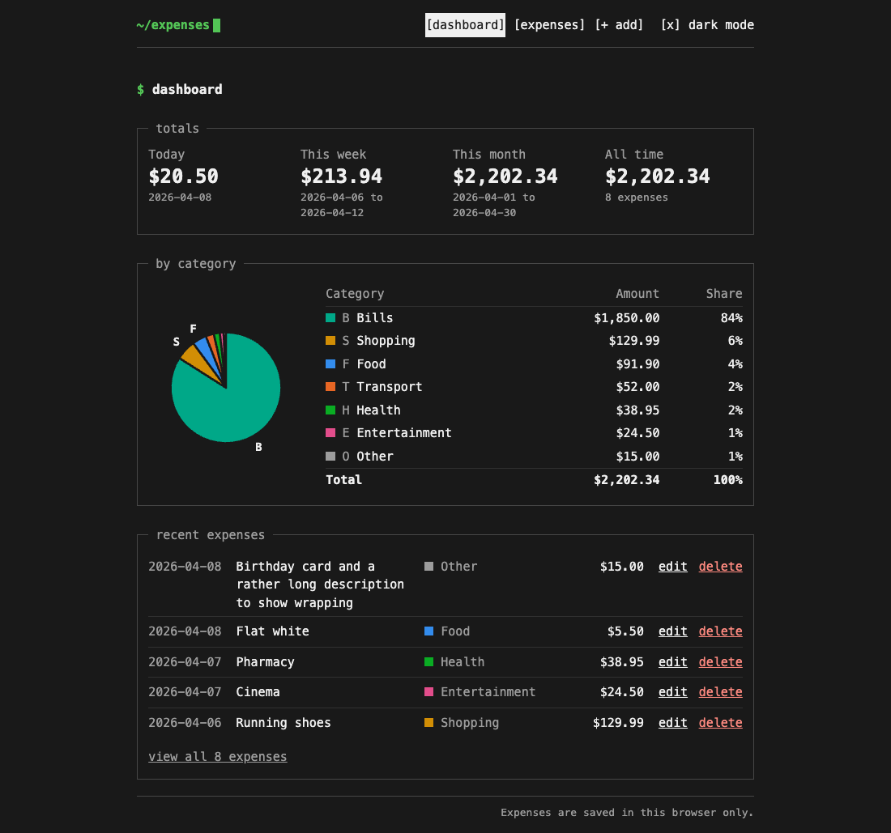
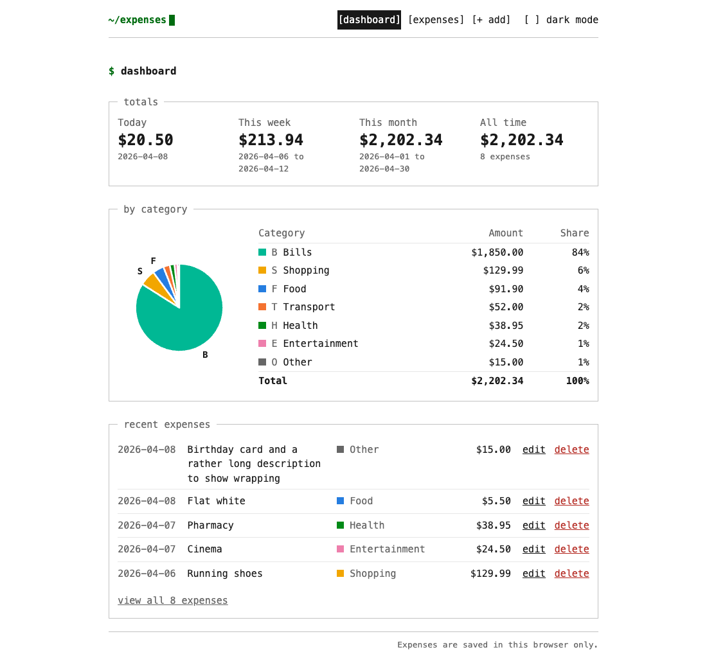

# expense-tracker

A minimal expense tracker with a terminal look. It is a static site: no server, no account, no build step. Your expenses are stored in the browser you enter them in.

| Dark | Light |
|---|---|
|  |  |

## What it does

- **Add, edit and delete expenses**: amount, date, description and one of seven categories.
- **Dashboard**: totals for today, this week (Monday to Sunday), this month and all time; a pie chart and table of spending by category; the five most recent expenses.
- **Expense list**: every expense, newest first, with search, category and date-range filters, and the count and sum of what matches.
- **Light and dark themes**: follows your system the first time, then remembers your choice.
- Works with a keyboard, a mouse or a touch screen, down to a 320 px wide phone.

Amounts are in Australian dollars. `docs/product.md` has the full behaviour.

## Run it locally

You need Python 3, which macOS and most Linux systems already have.

```sh
python3 -m http.server 4173
```

Then open <http://localhost:4173/public/>. Opening `index.html` straight from disk does not work, because browsers only load JavaScript modules over HTTP.

## Test it

```sh
npm test            # unit tests: Node 20 or newer
npm run test:e2e    # drives the real page in headless Chrome: Node 22 or newer, plus Chrome
```

To watch the browser run instead, start the local server and open <http://localhost:4173/tests/e2e/>. It uses a separate ledger named `e2e`, so it does not touch your own expenses.

No Node installed? If you have VS Code on a Mac, its bundled runtime does the job:

```sh
ELECTRON_RUN_AS_NODE=1 "/Applications/Visual Studio Code.app/Contents/MacOS/Code" --test
ELECTRON_RUN_AS_NODE=1 "/Applications/Visual Studio Code.app/Contents/MacOS/Code" tests/e2e/run.js
```

`node tests/e2e/run.js --screenshots screenshots` also saves a picture of every view in both themes at three widths.

## Deploy to Vercel

`vercel.json` already holds the settings: serve the `public` folder, no install, no build. Two ways to deploy:

- **From Git.** Push this repository, import it at <https://vercel.com/new>, and accept the defaults.
- **From the command line.** `npx vercel` creates a preview; `npx vercel --prod` publishes to production. This needs Node and a Vercel login.

After the first deployment, run the five deployed checks at the end of `docs/delivery.md`.

**Status: not deployed yet.** Everything in `docs/delivery.md` up to deployment has been run locally; its verification log has the details.

## Where your data lives

Expenses are saved in your browser's local storage for the address you opened the site at. That means:

- Another browser or device shows its own, separate ledger. There is no sync.
- Clearing the site's data in your browser deletes the ledger. There is no export yet.
- Every Vercel preview URL is a separate address with separate storage. Use the production address for real data.

## Change the defaults

`public/js/config.js` holds the currency, locale, first day of the week, categories and limits. Adding a category also needs a colour in `public/styles.css`. Renaming or removing a category makes saved expenses that use it unreadable, so migrate the data first.

Two URL parameters exist for testing and demos: `?profile=<name>` uses a separate ledger, and `?today=YYYY-MM-DD` treats that date as today.

## For people and agents working on the code

| File | Purpose |
|---|---|
| `AGENTS.md` | Commands, layout and the rules that keep the app correct. Read by Codex and Claude Code (`CLAUDE.md` imports it). |
| `docs/product.md` | What the app does and the decisions behind it. |
| `docs/delivery.md` | Build order, acceptance checks with known answers, deployment, and the verification log. |
| `prompts/build.md` | The prompt to build or change the app. |
| `prompts/review.md` | The brief for an independent reviewer. `.claude/agents/expense-reviewer.md` wraps it as a Claude Code subagent. |
